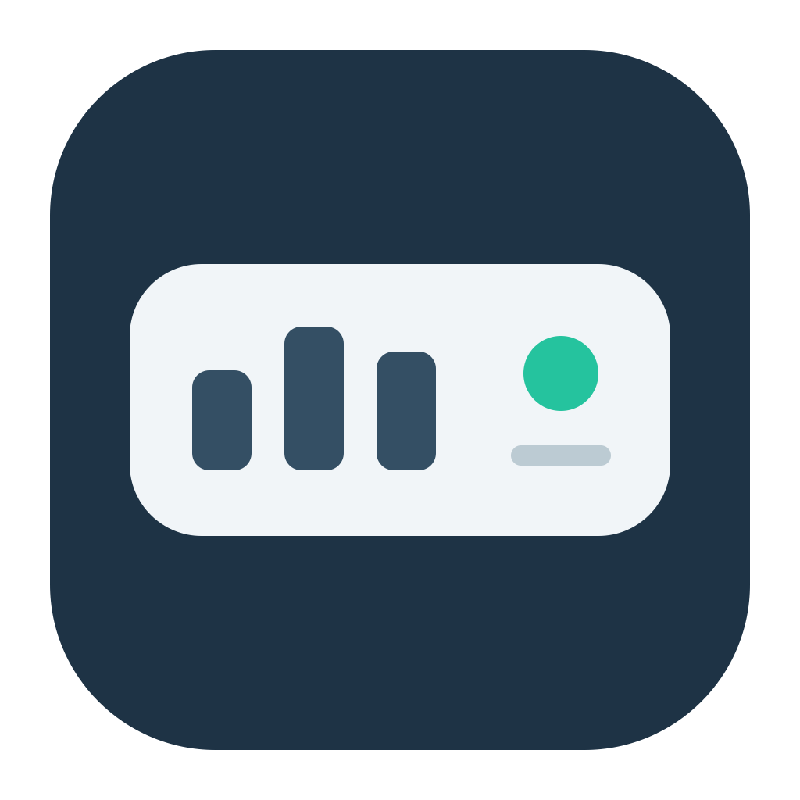

# Codex实时状态栏

**v1.7.3** 修复小窗显示恢复，区分主进程与命令行授权，并将菜单栏改为 CPU 图标与只读温度。详见[验证记录与兼容范围](docs/v1.7.3-validation.md)。

简体中文 · [English](README.en.md)



一个轻巧、半透明的 macOS 浮窗，用于查看 Codex 本地聊天用量。**日常监控不调用模型，不产生模型 token 消耗。**

**体积说明：** 状态栏 v1.7 整合包包含应用、技能及安装脚本，准确大小见发布页，通用应用解压后约1MB；GitHub Desktop 的数百MB安装包是另一个独立客户端，运行状态栏无需启动它。图标资源约94KB，PNG预览和矢量源文件不会打入应用。

这是独立的社区辅助应用，与 OpenAI、Codex 官方无隶属关系。


## 能做什么

- 自动跟随当前 Codex 聊天，或按名称搜索并固定监控。菜单不再展开最近聊天列表。
- 点击数字，查看累计 / 最近请求的 token、缓存命中口径和上下文估算。
- 65%仅橙色及点击建议；70%在真实任务正常结束后显示交接提示，不抢输入焦点。
- 一键复制 `$handoff` 指令，返回指定聊天，再由你粘贴并发送。
- 离开 Codex 自动隐藏，返回后先刷新聊天再显示。
- 保存透明度、窗口位置、提醒状态及上次准备交接的来源。
- `⋯ → 语言 / Language` 中切换简体中文与 English，立即生效并记住选择。聊天名称保持原文。

## 下载与开始使用

在[下载页面](https://github.com/yzx96728-alt/codex-realtime-statusbar/releases/latest)下载 `CodexRealtimeStatusbar-v1.7.3-macOS-universal.zip`，解压后在版本文件夹中得到应用、通用技能、安装脚本与中英文说明。构建包包含 Apple Silicon 和 Intel 两种架构，最低构建目标为 macOS 13。

1. 解压完整 ZIP，双击 `安装或升级.command`，一次安装应用和 handoff。旧版先退出、校验备份，再替换；技能相同跳过，修改需确认，多份同名暂停更新。
2. 优先 `/Applications`，不可写时须同意后使用 `~/Applications`。选择是否登录启动，并按提示在“系统设置 → 隐私与安全性 → 辅助功能”授权最终应用。有效授权直接复用，Ad-hoc更新仍可能需重新授权。
3. 在 Codex 中切换聊天。`↪` 代表跟随，`⌖` 代表固定监控。若尚未选择聊天，可先通过 `⋯ → 搜索聊天名称` 选择。
4. 点击三个数字查看详情，点击外部关闭。

**发布包使用本地 ad-hoc 签名，没有 Apple Developer ID 公证。** 若系统阻止打开，不需要降低系统安全设置；可以阅读源码并按下方步骤在本机构建。每次更新后以小窗实际识别结果核验辅助功能权限，而不是只看系统开关。

> ARM Mac 的实际验证环境：macOS 26.5.1。Intel 版本仅完成交叉编译，尚未在 Intel 机器实测。最低版本为构建目标，不代表已覆盖所有 macOS / Codex 组合。

## 语言

同一个应用包含中文和英文界面，无需分别安装。切换语言不会重置聊天选择、用量、权限或提醒记录；交接指令随所选语言变化。macOS 自带的系统对话框仍遵循系统语言。

## 指标口径

| 指标 | 含义 |
| --- | --- |
| Token | 该聊天累计输入 + 输出，包含重复发送的上下文。缓存属于输入，思考属于输出，不重复相加。 |
| 缓存 | 累计缓存输入 ÷ 累计输入。也可在详情查看最近请求。 |
| 上下文≈ | 普通请求总 token 或已确认压缩基线 ÷ 记录容量；缺失或未知不估算。 |
| 账号额度 | 取自所选聊天用量事件中的历史快照，显示来源与时间，不代表实时余额。 |

65%仅变色及点击建议；70%提示“建议准备交接”，可选“准备交接”或“暂不交接”。这是经验阈值，不是已经验证的最佳成本切换点。仅两分钟内的新用量且有匹配的正常完成事件才允许弹窗；首次历史读取、重复广播、取消、压缩基线、未知和不完整状态不触发。提醒绑定任务和压缩周期，压缩清除旧待提醒。档位跨重启去重，低于55%重新允许。

登录启动使用 macOS 原生登录项，可在“系统设置 → 通用 → 登录项（与扩展）”管理。小窗运行后隐藏待命，隐藏时停止定时刷新；主动退出后不会立即重启。没有运行中的小窗时，仅打开Codex不能唤起它。

## 交接

小窗只负责 **复制指令 + 返回来源聊天**，不编辑输入草稿、不发送消息、不创建聊天，也不生成摘要。需要你按 `⌘V` 并发送，才会由 Codex 实际执行并产生正常模型用量。

交接要求原目录、任务状态与权限边界被核验，接续聊天先核验再继续，并保留源聊天。**下载包已附通用 `handoff` 技能与安装脚本**，不是官方内置功能。将 `安装交接技能.command` 与 `skills` 文件夹放在一起，双击安装；技能无需 Python、计数器或 Hook。新安装位于 `~/.agents/skills/handoff`；已有传统目录安装则沿用原位置，替换前确认并备份至 `~/.codex-handoff-backups`。若发现多份同名技能则停止并列出位置。若系统阻止脚本，可按[使用说明](docs/使用说明.md)手动安装，无需降低安全设置。缺少可靠聊天 ID 或可核验目录时，相关按钮会禁用并说明原因。

单独输入 `$handoff` 默认仅保存进度；明确要求“保存、在原目录新建并打开聊天、核对后继续”才执行完整交接。缺少聊天管理工具时交付材料和手动接续开场指令；Plan 模式只制定方案。技能可独立使用，按用户语言工作。

“返回上次交接来源”是来源书签，不意味着交接已完成。

## 隐私与兼容性

数据来自本机 `~/.codex/state_5.sqlite` 和本地会话 JSONL 中的结构化用量 / 任务事件。跟随仅读取 Codex 当前窗口顶部元数据，优先明确聊天标识，其次唯一标题；同名、窗口歧义、缺失记录或权限失效时不猜测。

不截图、不 OCR、不上传数据、不引入后台模型进程或新服务。设置和来源书签保存在本机 UserDefaults。本仓库与下载包不包含维护者的聊天、私人路径、令牌、账号授权或本机备份；随附的仅为通用技能源码。

**依赖 Codex 当前本地索引和事件格式，后续客户端更新可能需要适配。** 本版不判断 Codex 内部首页或设置页是否应隐藏，账号快照也不等于真实账单或费用。Codex 仍负责自动压缩；小窗不调整其设置，也不提供手动压缩按钮。

## 从源码构建

需要 macOS、Xcode Command Line Tools、Swift、系统 SQLite。无需安装第三方包。

```bash
./scripts/test.sh
./scripts/package.sh
```

输出在 `dist/`。默认生成 universal 应用；单架构构建可使用：

```bash
ARCHITECTURES=arm64 ./scripts/build.sh
```

可选本机目录读取验证：`./scripts/test.sh --live-catalog`，会只读本机 Codex 目录索引；默认测试只使用隔离的模拟数据。

编译后先完成整包签名，再为最终应用更新原有授权；验收期间避免反复替换已授权二进制。

## 目录

- `Sources/`：浮窗、跟随、聊天选择、用量与提醒状态。
- `Tests/`：用量口径、阈值、完成事件门控、重启去重、聊天匹配与指令校验。
- `Resources/AppIcon.icns` 与 `Resources/icons/`：应用图标、可编辑矢量源文件及预览。
- `scripts/make-icon.swift`：在本机生成标准尺寸图标，不调用模型。
- `Resources/Info.plist`：通用应用信息，不含本机初始聊天路径。
- `scripts/`：构建、测试、打包。
- `skills/handoff/`：可独立安装的轻量通用交接技能；根目录 `.command` 为 macOS 安装脚本。
- [完整使用说明](docs/使用说明.md)

命令与链接参考：[Codex 开发者命令](https://learn.chatgpt.com/docs/developer-commands)、[聊天链接](https://learn.chatgpt.com/docs/reference/commands)。

## CPU温度与升级授权

菜单栏每10秒读取CPU传感器最高温度，M1系列有明确键表，M1 Max已实测；Intel TC0D仅尝试读取、未实机验证，其他系列暂显示不可用。缺失或过期显示横线，不安装提权服务、不写风扇、不调用模型。

Ad-hoc升级后，蓝色辅助功能开关仍可能保存旧版签名。如主进程仍被拒绝，退出小窗，在“系统设置 → 隐私与安全性 → 辅助功能”仅移除它的旧条目，从最终安装路径重新添加并亲自认证，再打开同一份应用。不修改TCC数据库或放宽签名。命令行独立探针可能仍为false，以运行中GUI的状态和实际跟随为准。
